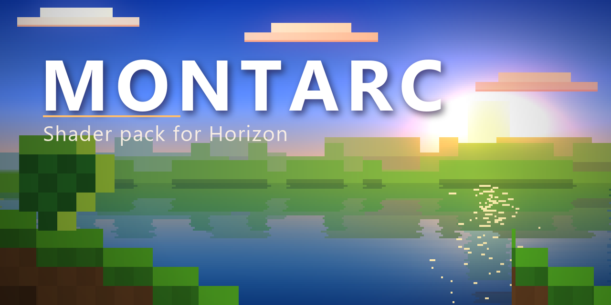
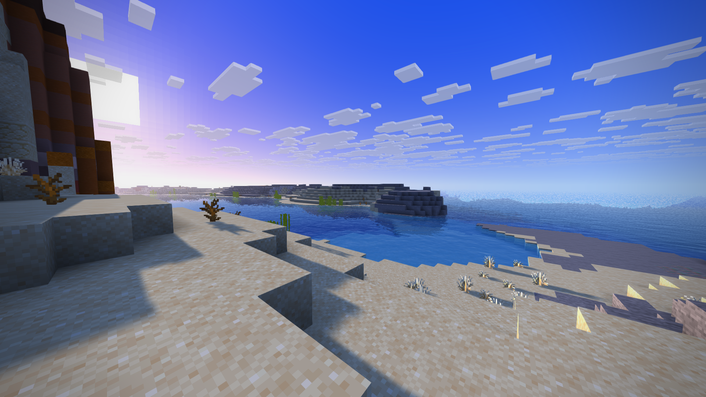
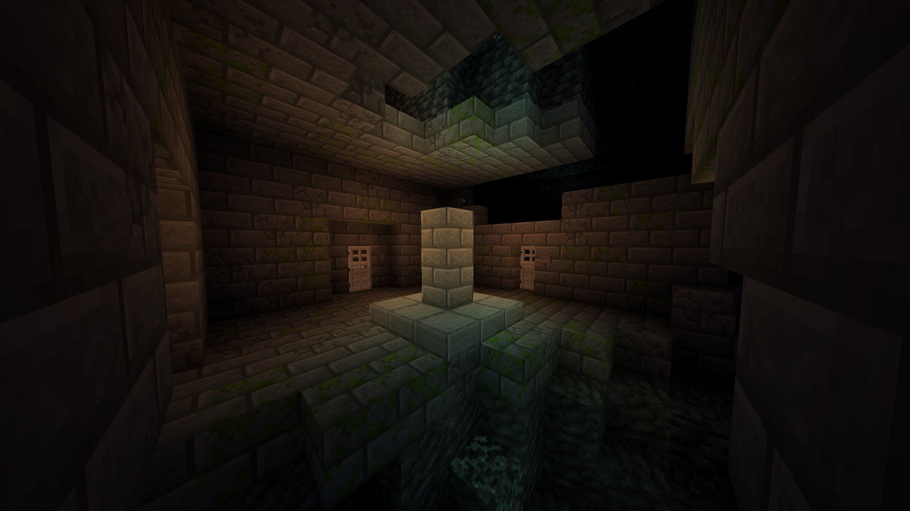
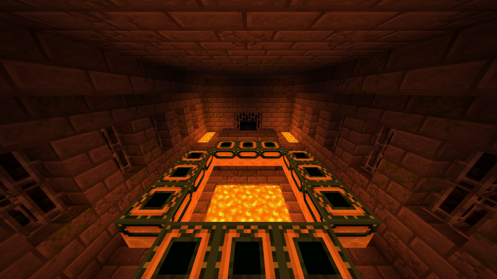
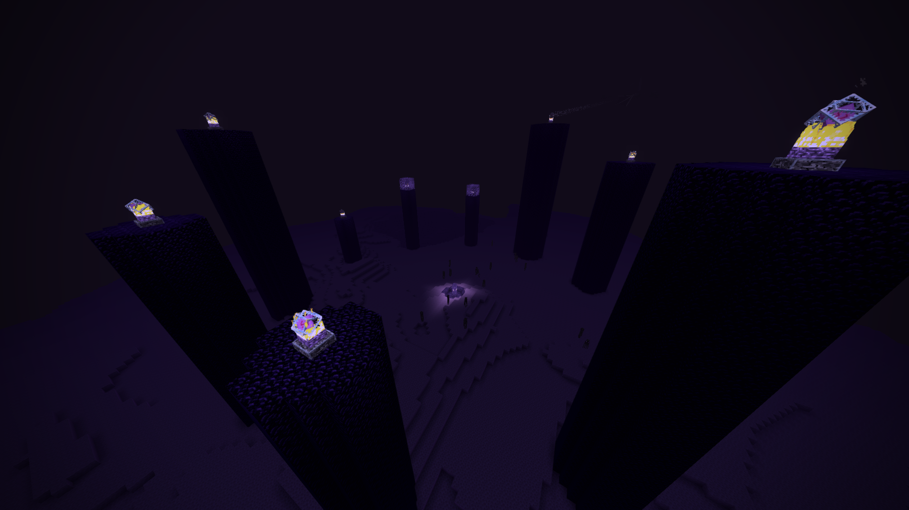
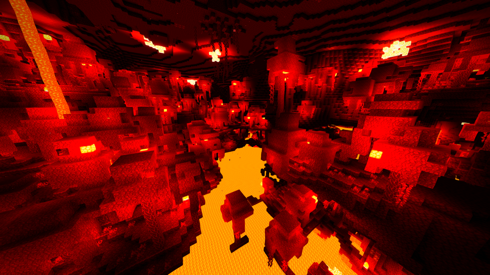
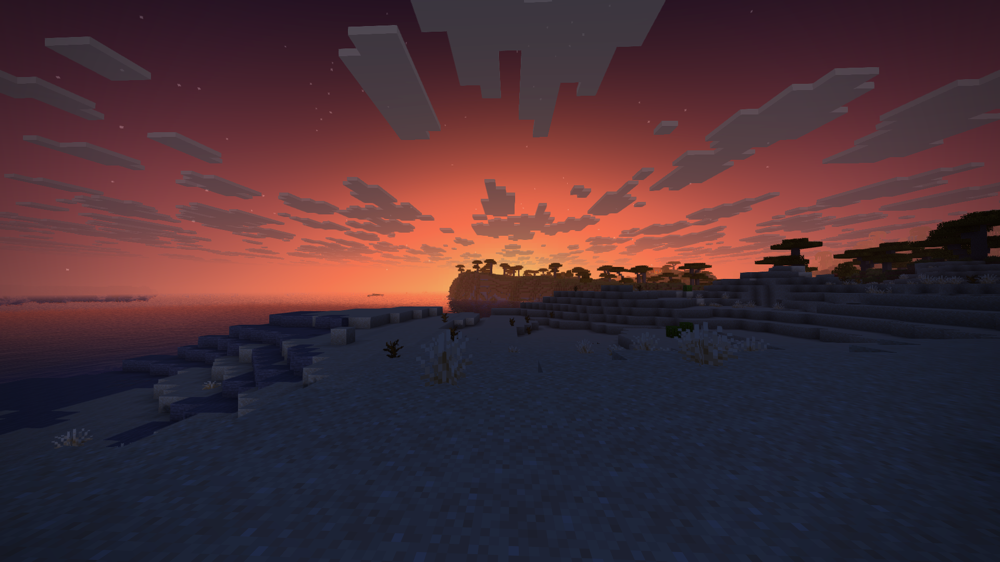
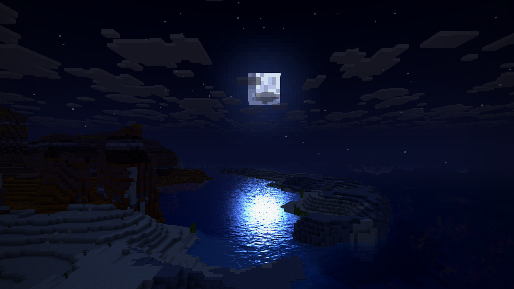

# Montarc



Bright, colorful shader pack for Horizon. Horizon had no shaders on the registry, so I made one. Style is close to Complementary Reimagined, but the code is mine, written from scratch in WGSL.

## What you get

- **Soft shadows.** Sun and moon cast them. Water and stained glass tint the light that goes through.
- **Sky and fog match.** Blue day, orange sunsets, dark blue night. Far terrain fades into the sky, no hard line at the horizon.
- **Colored light.** Torches are warm, soul fire is blue, redstone is red, sea lanterns are cyan, amethyst is purple.
- **Water that looks like water.** Waves, depth color, reflections, sun glitter and foam on the shore.
- **Wind.** Grass, flowers, crops and leaves move. Rain makes it stronger.
- **Nether and End look different.** Nether is hot and hazy, with heat shimmer. End is cold and purple.
- **29 options.** Everything can be tuned or turned off in game.

## Screenshots









## Install

- Put `montarc-x.y.z.hshader` in the `shaderpacks` folder next to `options.txt`. Don't unzip it.
- Options > Horizon Settings > Shader Packs > Montarc.
- Click it again to turn it off.

You need the nightly build of Horizon (2026-11-04 or newer). The older native build refuses the pack because its shader API is smaller.

## Slow? Try this

- Shadow quality: Low
- Water reflections: off
- Bloom: off
- Shadows: off. Biggest gain.

Montarc aims for about 3 ms of GPU time.

## Known problems

- Horizon shader API is 0.1, experimental. It can change.
- Entities, block entities and particles are not shaded yet. There is no stage for them.
- Nether and End sky is vanilla. The sky stage only draws in the Overworld.
- Shadow bias may need tuning on some GPUs. If you see stripes on surfaces, change `Shadow bias`.

## License

MIT. Fan project, not affiliated with Horizon or Mojang.

## Layout

- `pack/montarc/`: the shader pack (manifest and WGSL files).
- `horizon-registry.toml`: the page text for the Horizon registry.
- `docs/cover.png`: cover image.
- `docs/screenshots/`: in-game screenshots.

## Build

```sh
cargo install --git https://github.com/horizon-rust/horizon horizon-shader-api
horizon-shader check pack/montarc
horizon-shader pack pack/montarc
```
